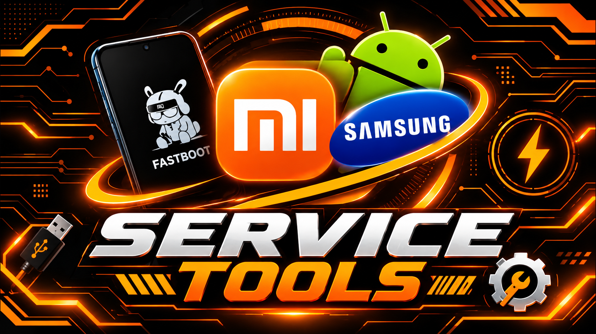

🛠️ LEINX6 — SERVICETOOL

Your Android Service Toolkit

A powerful Termux-based tool designed to bring PC-like servicing and capabilities to your Android device through OTG.

Exclusive: 
- Brom TOOLS ( NOT TESTED YET )
- SAMSUNG TOOLS ( NOT TESTED YET )
- MITOOLS

---

🟠 REQUIREMENTS

Before starting, make sure you have:

- Termux
- Termux:API
- USB OTG support
- A compatible target device

Initial Setup

Open Termux and run:
```bash
termux-setup-storage
```


Grant the requested storage permissions.

---

🔵 STEP 1 — CREATE YOUR ACCOUNT

Visit the official Leinx6 Cloud website:

🌐 https://leinx6cloud.pythonanywhere.com

1. Create your account.
2. Log in using your username and password or your google account .
3. Locate your cURL Token.
4. Copy the token and paste it into your Termux terminal.
5. Run the command provided by the website.

---

🟣 STEP 2 — INSTALL SERVICETOOL

Once the token command has been executed successfully, run:
```bash
servicetool --setup
```


When prompted for the setup password, enter:

```bash
lowleveltools
```

---

🟢 STEP 3 — LOGIN

After the setup process, log in through the Termux terminal using the same account you created on the Leinx6 Cloud website.

Enter your account credentials when requested.

---

🟡 STEP 4 — DOWNLOAD REQUIRED FILES

The tool will begin downloading its required files.

When prompted to install MiTools, you will see:

Download MiTools? (Y/N)

Enter:
```bash
Y
```


Then press Enter to continue.

Wait for the installation process to finish.

---

🔴 STEP 5 — CONNECT YOUR DEVICE

1. Connect the target phone to your Android device using an OTG adapter.
2. Enable USB Debugging on the target phone if you intend to use ADB tools.
3. Accept the USB debugging authorization prompt on the target device, if shown.
4. Make sure the OTG connection is detected.

You're ready to use the available servicing features!

---

⚡ QUICK START — FUTURE USE

Once everything is installed, you don't need to repeat the setup process.

Simply open Termux and run:

```bash
servicetool
```

That's it!

---

LEINX6 SERVICE TOOL

Android Servicing • OTG • ADB • Termux

Made for the Android community by Leinx6 !
